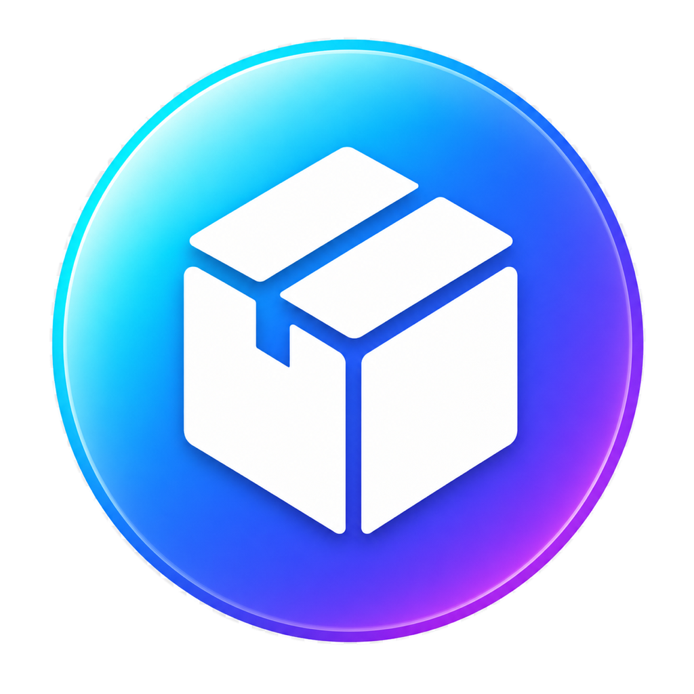
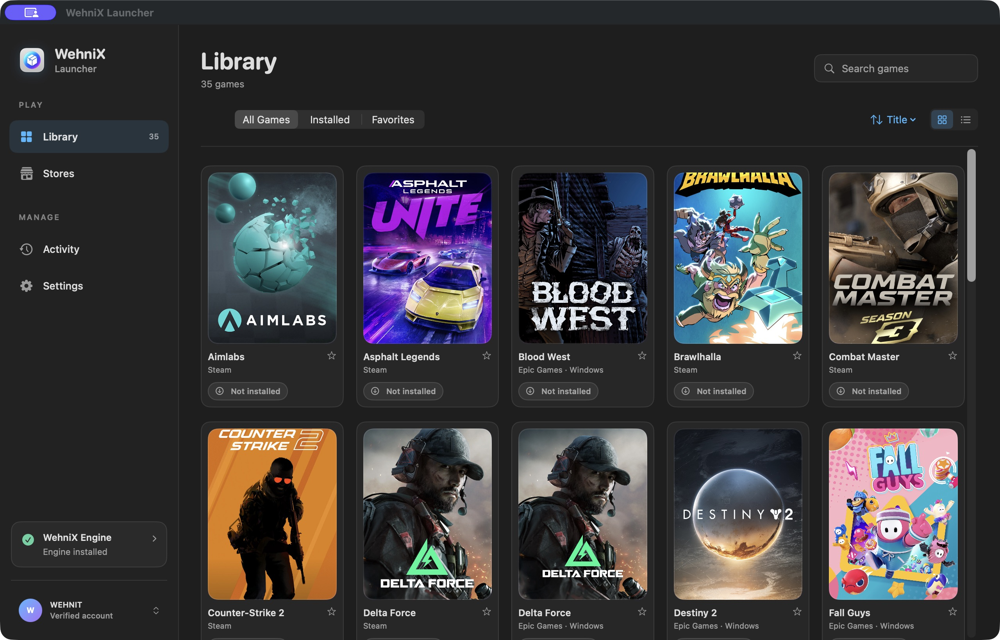

# WehniX Launcher

  

[Website](https://wehnix-launcher.wehnit-studios.workers.dev) · [Releases](https://github.com/wehnnit/WehniX-Launcher/releases) · [Report a bug](https://github.com/wehnnit/WehniX-Launcher/issues)

A native Mac launcher for managing game libraries, Windows runtimes and game sessions. When a PlayStation or Xbox controller is connected, an optional console layout opens with the same library and the same per-game configuration; moving the mouse or trackpad returns to the desktop layout. Optional Discord Rich Presence shows launcher pages and the game you are viewing or running when the local Discord app is available.

**Public beta 1.0.5-beta.7** — [Download for Mac](https://github.com/wehnnit/WehniX-Launcher/releases/tag/v1.0.5-beta.7). Free for personal, noncommercial use. This build fixes Install Update & Quit, which could leave the launcher waiting instead of quitting to install.

## Controller layout

Connect a PlayStation 4, PlayStation 5 or Xbox controller over USB or Bluetooth and the launcher opens a console layout with your library. Opening a game shows the saved runtime, graphics and launch settings before you press Play, and starting still needs an explicit button press. Moving the mouse, trackpad or keyboard returns to the desktop layout, and controller input brings the console layout back. The behaviour can be turned off in Settings → Controller.

## Requirements

| | Current bundled gaming configuration |
| --- | --- |
| Mac | Apple silicon required for the combined bundled gaming configuration. Intel runtime support depends on runtime and game. |
| macOS | macOS 26.4 or later for the combined bundled gaming configuration. The launcher interface has an older OS floor, but bundled native Wine and Linux D3DMetal require 26.4. |
| Memory | 16 GB RAM recommended, with 32 GB or more recommended for demanding games. These are recommendations. A tested minimum has not been established. Current development verification uses an M4 Pro with 48 GB. |
| Storage | Approximately 2 GB for the app bundle. Plan for at least 15 GB of free space for app installation and initial runtime setup, plus each game's requirements. Keep 20 GB or more available when updating runtimes. These are storage planning recommendations. Runtime extraction, caches and retained recovery versions vary by usage. |
| Compatibility | Support varies by game, graphics backend and runtime. Compatibility and performance on every Mac or game have not been established. |

## Installation

Download the beta DMG from [Releases](https://github.com/wehnnit/WehniX-Launcher/releases), open it and drag WehniX Launcher to Applications. For an ad-hoc signed beta, macOS may require you to open System Settings → Privacy & Security and choose Open Anyway after the first launch attempt. An ad-hoc signature does not provide Apple Developer ID publisher verification or notarization. Review the release notes and checksum before approving it. Launch from Applications and follow setup. Keep additional free space available for game installs and runtime updates.

## Updates

The launcher checks published releases automatically. It verifies downloads with the pinned publisher key and installs app updates on idle quit. After an app update, WehniX prepares newer bundled engine versions when games and save operations finish. Pinned games keep their existing engine version. The release website shows the current beta download automatically.

[Terms](https://wehnix-launcher.wehnit-studios.workers.dev/tos.html) · [Privacy](https://wehnix-launcher.wehnit-studios.workers.dev/privacy.html)

## Support

Report beta bugs through [Issues](https://github.com/wehnnit/WehniX-Launcher/issues). Include macOS version, Mac chip, RAM, launcher version, selected runtime and steps to reproduce. Redact account identifiers, tokens and personal paths from logs. Save files and installed games should be backed up before beta testing.

## License

WehniX Launcher is proprietary software. This repository contains public release materials and approved release assets. Third-party components retain their own licenses and corresponding-source rights. See [LICENSE](LICENSE) and [THIRD-PARTY.md](THIRD-PARTY.md).
